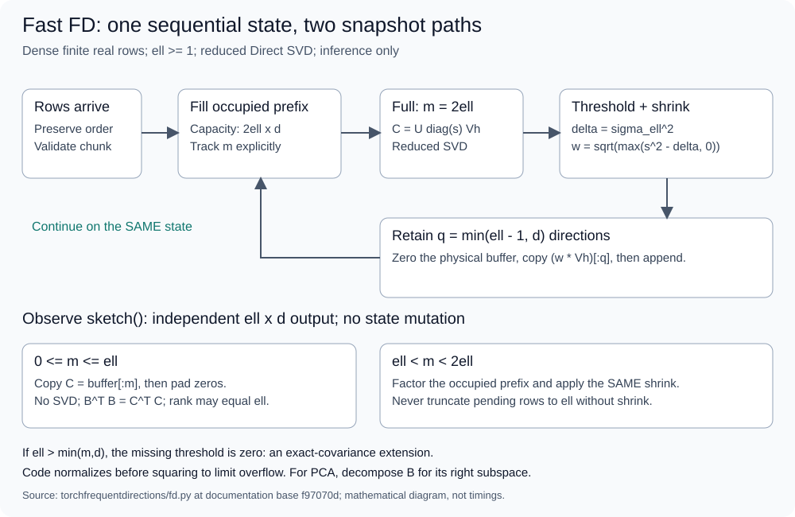
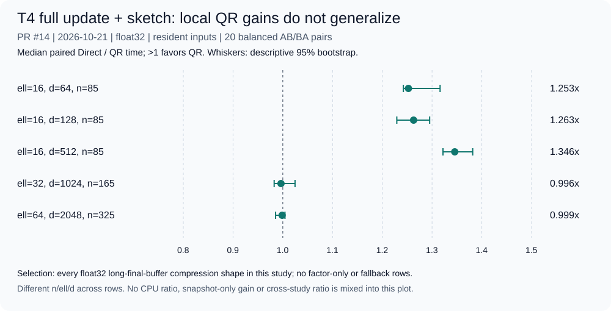

# TorchFrequentDirections

[English](README.md) | [简体中文](README.zh-CN.md)

基于原生 PyTorch 的流式矩阵摘要：提供参考版与缓冲版 Frequent Directions，
用于协方差近似和右奇异子空间估计。
提供 CPU 与 NVIDIA T4 实验、PyTorch 编译研究及可复现的性能报告。


[文档中心](docs/README.md) · [数学保证](docs/performance/README.md#mathematical-contract) ·
[性能研究](docs/performance/README.md) · [实测数据](docs/performance/measurements.md)

## 从生产 API 开始

在本地检出目录中，使用 Python >=3.10，并预先安装兼容的 PyTorch >=2.0，
然后安装本地包：

```sh
python -m pip install --no-deps --no-build-isolation .
```

本地构建需要 setuptools >=68；也可以使用 `pip install .` 自动解析构建与运行依赖。

```python
import torch
from torchfrequentdirections import FrequentDirections, fast_fd, reference_fd

generator = torch.Generator().manual_seed(1729)
a = torch.randn(100, 20, generator=generator, dtype=torch.float64)
b = fast_fd(a, ell=8)
reference = reference_fd(a, ell=8)

stream = FrequentDirections(8, a.shape[1], dtype=a.dtype, device=a.device)
stream.update(a[:37]).update(a[37:])
snapshot = stream.sketch()
assert b.shape == reference.shape == snapshot.shape == (8, 20)
assert snapshot.dtype == a.dtype and snapshot.device == a.device
assert not snapshot.requires_grad
```

`reference_fd` 每读入一行就执行一次收缩；`fast_fd` 和默认流式对象使用容量为
`2*ell` 的缓冲区与 **Direct SVD**。两种调度不必返回相同的因子。
`sketch()` 返回独立副本，不改变流式状态，之后仍可继续更新。
请让配置的 `device`、`dtype` 与输入一致：实现不会隐式转换设备或数据类型。
使用 CUDA 需要已有的合适 torch 安装；上述示例特意仅使用 CPU。

## 哪些已经交付，哪些仍是研究？

| 能力 | 当前状态 |
|---|---|
| 参考版与缓冲版 Fast FD；严格有限性检查 | 生产实现，已有 CPU 及限定范围内的真实 T4 正确性证据 |
| 短缓冲区快照不调用 SVD | **已交付**：占用行数 <=ell 时无损复制并补零；PR #6 |
| QR + Small SVD | 实验性 CPU/CUDA 模块；收益或退化取决于形状和线程数，未接入自动后端选择 |
| `torch.compile` / Inductor | 已在 T4 测得实验性**逐点收缩**融合；尚无获验收的完整 FD 加速 |
| ScratchFD 局部张量复用 | 实验性；完整工作负载 0/26 通过性能筛选，其中 11/26 因对照不稳定而结论不确定 |
| CUDA Graphs | 逐点运算捕获与回放通过；被测配置中的 SVD 捕获失败，尚无保持严格语义的完整流式图 |
| 去除物理缓冲区清零 | 已否决：计时证据混合或无明确收益，且隐式 pickle 的尾部状态不同 |

[当前证据索引](docs/README.md#accepted-evidence-map) 收录了截至 PR #19 已合并的研究。
索引同时记录实验模块和历史报告的状态。

## 算法与保证



*缓冲区填满后执行一次依赖当前状态的收缩，再在同一状态上继续处理输入。
短快照直接复制，较长快照需要额外收缩。
[图表来源与重生成方式](docs/assets/README.md)。图中英文文字沿用原图。*

对于有 `n` 行、`d` 个特征的有限实数矩阵 `A`，输出 `B` 的形状为 `(ell,d)`。
在精确算术下，对每个满足 `0 <= k < ell`、`k <= d` 的整数，均有：

```text
0 <= A.T A - B.T B <= ||A - A_k||_F^2 / (ell - k) * I
||A - A V_k V_k.T||_F^2 <= ell / (ell - k) * ||A - A_k||_F^2
```

矩阵不等式采用半正定序；`A_k` 是最佳秩 k 近似，`V_k` 包含 B 的前 k 个
**右奇异向量**。短快照的行不必按 SVD 方向排列，其秩也不必为 `ell-1`：
直接截取摘要的原始行并不能选出 PCA 分量。奇异向量的符号，以及重复奇异值
对应子空间的基，都可能不同。

实现依据 [Ghashami、Liberty、Phillips 与 Woodruff 的 Frequent Directions，
arXiv:1501.01711v2](https://arxiv.org/abs/1501.01711v2)，并包含文档说明的
固定大小快照及 `ell>d` 扩展。参见[推导与数值边界](docs/performance/README.md#mathematical-contract)
和保留的[基础研究记录](docs/research/frequent-directions-tensorization.md)。

## 在大语言模型与视觉语言模型中的潜在应用

Frequent Directions 能以紧凑的流式摘要表示高维特征。基于其协方差和右奇异子空间近似性质，
结合 [FD 原始研究](https://arxiv.org/abs/1501.01711) 与
[Sketchy 优化器研究（NeurIPS 2023）](https://papers.nips.cc/paper_files/paper/2023/hash/ef72fa6579401ffff9da246a5014f055-Abstract-Conference.html)，
可以探索以下方向：

| 研究方向 | FD 可以发挥的作用 |
|---|---|
| LLM 激活分析 | 在线摘要隐藏层激活，以 `B.T @ B` 近似未中心化二阶矩，分析表示的主要子空间。 |
| 优化器统计 | 摘要梯度或因子统计量，探索受 Sketchy 启发的低秩预条件方法。 |
| VLM 表示分析 | 对维度兼容的图像、文本投影嵌入进行流式摘要，研究主要方向与表示漂移。 |
| 持续学习 | 跨任务保留紧凑的特征或梯度子空间摘要，用于漂移分析和正则化方法探索。 |

这些属于潜在集成方向，并非本仓库已交付的 LLM/VLM 工作流。
中心化协方差需要额外跟踪均值，优化器集成需要独立的训练实现。
草图存储量为 `O(ell * d)`，端到端显存和运行成本取决于模型及训练流程。

## 性能：实测结果



*真实 T4、float32、输入已驻留设备的完整调用（PR #14）。图中展示配对中位数及
描述性 bootstrap 区间。[测量数据、源码 SHA 与实验协议](docs/performance/measurements.md)。*

默认缓冲实现使用 **Direct SVD**。研究实验还覆盖 QR + Small SVD、
逐点 `torch.compile` 融合、ScratchFD 和 CUDA Graphs：

- **短快照：** 已交付的快速路径在缓冲区占用不超过 `ell` 行时省去一次额外 SVD。
- **QR + Small SVD：** 性能随矩阵形状、设备和线程设置变化，目前属于实验后端。
- **逐点编译：** 实测 T4 收缩算子的 kernel 启动次数由 10 降至 1；完整工作负载编译性能筛选为 0/30。
- **ScratchFD：** 完整工作负载性能筛选为 0/26，其中 11 组对照结果不确定。
- **CUDA Graphs：** 逐点运算捕获与回放成功；被测环境中的 SVD 捕获失败。

[综合性能研究](docs/performance/README.md) 汇总实验配置、正面与负面结果，
以及 CPU 和 T4 的性能比较。

## 输入、数值与验证边界

- 输入为稠密、有限实数的 **2D float32/float64** 张量，`ell` 和 `d` 为正整数。
  支持空流、短流及非连续存储的稠密输入。`ell>d` 是精确算术下保持精确协方差的
  扩展，不具有压缩优势。
- 仅用于推断：更新会 detach 输入，不保留 autograd 图。不支持 half/bfloat16、
  复数或稀疏输入，也不支持通过摘要进行训练。
- 无效输入在状态修改前被拒绝。发生 SVD/后端故障后应丢弃该实例。
  输入有限并不保证每次极端尺度的 SVD 都能成功；输出有限性检查始终严格保留。
- 已记录的 CPU 验证环境为 Python 3.12.3 / torch 2.11.0+cpu。
  真实 T4 研究环境为 Python 3.13.15 / torch 2.11.0+cu130、CUDA 13.0，
  使用 float32/64。这些是有界配置下的证据，不是对每种 GPU、torch 版本或长流的保证。
- 独立 float64 协方差、谱尾与投影 oracle 使用随维度和能量缩放的容差；
  [综合研究](docs/performance/README.md#mathematical-contract) 记录的容差为
  `32*eps(input dtype)*max(n,d,2ell,1)*||A||_F^2`。
  这并非微小奇异值相对精度或任意有限精度流的证明。TPU 及其他加速器尚未验证。
  在已测路径中，保持完整严格语义的 FD 编译/图加速尚不可用，应与已测得的局部融合区分。

本地检查命令如下（CPU-only torch 即可）：

```sh
python -m unittest discover -s tests -v
python scripts/validate_cpu.py
python scripts/check_snapshot.py
python docs/tools/build_figures.py --check
python docs/tools/verify_docs.py --run-example
```

这些命令运行本地测试与文档检查。

## 许可证与研究工作流

项目代码与原创图表采用 [MIT 许可证](LICENSE)；固定的
[SAE V3.3 快照](.sae/AGENTS.md) 保留其自身的 MIT 许可证。
本仓库不重新分发原论文、私有数据集或第三方实现。
未启用 GitHub Actions 或后台计算。[项目规则](AGENTS.md) 将实现与证据工作交由 Codex，
独立科学审查与合并决定交由 GPT 架构师。
