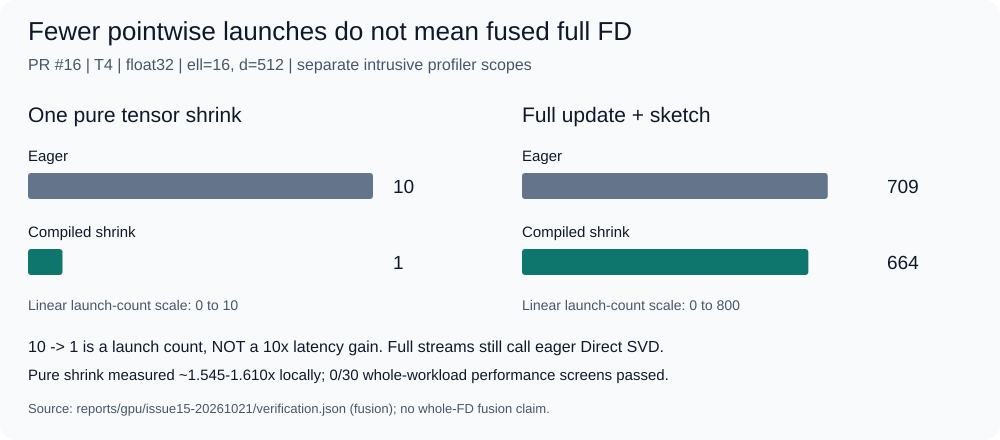

# TorchFrequentDirections

[English](README.md) | [简体中文](README.zh-CN.md)

基于原生 PyTorch 的流式矩阵摘要：提供参考版与缓冲版 Frequent Directions，
用于协方差近似和右奇异子空间估计。
CPU、真实 T4 与编译实验用于探索性能；**不保证默认实现具有 GPU 加速优势**。


[文档中心](docs/README.md) · [数学保证](docs/performance/README.md#mathematical-contract) ·
[性能研究](docs/performance/README.md) · [实测数据](docs/performance/measurements.md)

## 从生产 API 开始

在本地检出目录中，使用 Python >=3.10，并预先安装兼容的 PyTorch >=2.0，
然后安装本地包：

```sh
python -m pip install --no-deps --no-build-isolation .
```

此命令安装当前检出版本，并不表示项目已经在 PyPI 发布。构建需要 setuptools
>=68；必要时，`pip install .` 可以解析并安装构建及运行依赖。
包元数据允许的版本范围，不等于每个版本都已通过验证。

```python
import torch
from torchfrequentdirections import FrequentDirections, fast_fd, reference_fd

generator = torch.Generator().manual_seed(1729)
a = torch.randn(100, 20, generator=generator, dtype=torch.float64)
b = fast_fd(a, ell=8)
reference = reference_fd(a, ell=8)

stream = FrequentDirections(8, a.shape[1], dtype=a.dtype, device=a.device)
stream.update(a[:37]).update(a[37:])
snapshot = stream.sketch()
assert b.shape == reference.shape == snapshot.shape == (8, 20)
assert snapshot.dtype == a.dtype and snapshot.device == a.device
assert not snapshot.requires_grad
```

`reference_fd` 每读入一行就执行一次收缩；`fast_fd` 和默认流式对象使用容量为
`2*ell` 的缓冲区与 **Direct SVD**。两种调度不必返回相同的因子。
`sketch()` 返回独立副本，不改变流式状态，之后仍可继续更新。
请让配置的 `device`、`dtype` 与输入一致：实现不会隐式转换设备或数据类型。
使用 CUDA 需要已有的合适 torch 安装；上述示例特意仅使用 CPU。

## 哪些已经交付，哪些仍是研究？

| 能力 | 当前状态 |
|---|---|
| 参考版与缓冲版 Fast FD；严格有限性检查 | 生产实现，已有 CPU 及限定范围内的真实 T4 正确性证据 |
| 短缓冲区快照不调用 SVD | **已交付**：占用行数 <=ell 时无损复制并补零；PR #6 |
| QR + Small SVD | 实验性 CPU/CUDA 模块；收益或退化取决于形状和线程数，未接入自动后端选择 |
| `torch.compile` / Inductor | 已在 T4 测得实验性**逐点收缩**融合；尚无获验收的完整 FD 加速 |
| ScratchFD 局部张量复用 | 实验性；完整工作负载 0/26 通过性能筛选，其中 11/26 因对照不稳定而结论不确定 |
| CUDA Graphs | 逐点运算捕获与回放通过；被测配置中的 SVD 捕获失败，尚无保持严格语义的完整流式图 |
| 去除物理缓冲区清零 | 已否决：计时证据混合或无明确收益，且隐式 pickle 的尾部状态不同 |

[当前证据索引](docs/README.md#accepted-evidence-map) 收录了截至 PR #19 已合并的研究。
研究证据获验收，**不等于**其原型已成为公共 API。
历史报告保留当时的“等待审查”等措辞；索引说明其后续处理结果。

## 算法与保证


*缓冲区填满后执行一次依赖当前状态的收缩，再在同一状态上继续处理输入。
短快照直接复制，较长快照需要额外收缩。
[图表来源与重生成方式](docs/assets/README.md)。图中英文文字沿用原图。*

对于有 `n` 行、`d` 个特征的有限实数矩阵 `A`，输出 `B` 的形状为 `(ell,d)`。
在精确算术下，对每个满足 `0 <= k < ell`、`k <= d` 的整数，均有：

```text
0 <= A.T A - B.T B <= ||A - A_k||_F^2 / (ell - k) * I
||A - A V_k V_k.T||_F^2 <= ell / (ell - k) * ||A - A_k||_F^2
```

矩阵不等式采用半正定序；`A_k` 是最佳秩 k 近似，`V_k` 包含 B 的前 k 个
**右奇异向量**。短快照的行不必按 SVD 方向排列，其秩也不必为 `ell-1`：
直接截取摘要的原始行并不能选出 PCA 分量。奇异向量的符号，以及重复奇异值
对应子空间的基，都可能不同。

实现依据 [Ghashami、Liberty、Phillips 与 Woodruff 的 Frequent Directions，
arXiv:1501.01711v2](https://arxiv.org/abs/1501.01711v2)，并包含文档说明的
固定大小快照及 `ell>d` 扩展。参见[推导与数值边界](docs/performance/README.md#mathematical-contract)
和保留的[基础研究记录](docs/research/frequent-directions-tensorization.md)。

## 性能：先看测量范围，再看比值


*PR #14，单次 T4 研究，float32，输入已驻留设备的完整调用。
点与误差线分别表示配对比值的中位数和描述性 bootstrap 区间，不代表普遍加速。
QR 仍是研究原型。[中位数、源码 SHA 与实验协议](docs/performance/measurements.md)。*

已交付的短快照优化，只在其适用路径上省去最终一次 SVD；
快照单独计时的收益不等于完整流式处理的收益。QR 的收益取决于形状和设备。
编译逐点收缩在实测用例中把 kernel 启动次数从 10 次降为 1 次，
但**完整工作负载的编译性能筛选为 0/30 通过**。
ScratchFD 同样没有通过性能筛选。CPU/GPU 配对上下文的漂移限制了设备间比较。
[综合研究](docs/performance/README.md) 同时保留正面、负面及不确定结果，
不会把不同计时块的比值相乘。

CUDA Graphs 的负结果限定于被测 T4、torch/CUDA 版本及预分配输出的 SVD 调用：
逐点捕获可用，含 SVD 的探针在 cuSOLVER 调用处失败；不能据此断言所有配置下的
cuSOLVER 都不兼容 CUDA Graphs。独立探针也不等于保持严格检查语义的完整 FD 图。



*复用原英文融合图：PR #16 中，单次逐点收缩为 10→1 次 kernel 启动；
另行 profiling 的 float32、ell=16、d=512 完整流式调用为 709→664 次。
这是两个独立范围的启动计数，**不是 10 倍运行加速，也不是完整 FD 融合**。
[图表来源与范围说明](docs/assets/README.md)。*

## 输入、数值与验证边界

- 输入为稠密、有限实数的 **2D float32/float64** 张量，`ell` 和 `d` 为正整数。
  支持空流、短流及非连续存储的稠密输入。`ell>d` 是精确算术下保持精确协方差的
  扩展，不具有压缩优势。
- 仅用于推断：更新会 detach 输入，不保留 autograd 图。不支持 half/bfloat16、
  复数或稀疏输入，也不支持通过摘要进行训练。
- 无效输入在状态修改前被拒绝。发生 SVD/后端故障后应丢弃该实例。
  输入有限并不保证每次极端尺度的 SVD 都能成功；输出有限性检查始终严格保留。
- 已记录的 CPU 验证环境为 Python 3.12.3 / torch 2.11.0+cpu。
  真实 T4 研究环境为 Python 3.13.15 / torch 2.11.0+cu130、CUDA 13.0，
  使用 float32/64。这些是有界配置下的证据，不是对每种 GPU、torch 版本或长流的保证。
- 独立 float64 协方差、谱尾与投影 oracle 使用随维度和能量缩放的容差；
  [综合研究](docs/performance/README.md#mathematical-contract) 记录的容差为
  `32*eps(input dtype)*max(n,d,2ell,1)*||A||_F^2`。
  这并非微小奇异值相对精度或任意有限精度流的证明。TPU 及其他加速器尚未验证。
  在已测路径中，保持完整严格语义的 FD 编译/图加速尚不可用，应与已测得的局部融合区分。

本地检查命令如下（CPU-only torch 即可）：

```sh
python -m unittest discover -s tests -v
python scripts/validate_cpu.py
python scripts/check_snapshot.py
python docs/tools/build_figures.py --check
python docs/tools/verify_docs.py --run-example
```

这些命令不会分配云端硬件。本次文档更新只验证图表、链接和示例，
不开展新的性能实验。三张图均直接引用原英文 SVG，不翻译、复制或修改图像。

## 许可证与研究工作流

项目代码与原创图表采用 [MIT 许可证](LICENSE)；固定的
[SAE V3.3 快照](.sae/AGENTS.md) 保留其自身的 MIT 许可证。
本仓库不重新分发原论文、私有数据集或第三方实现。
未启用 GitHub Actions 或后台计算。[项目规则](AGENTS.md) 将实现与证据工作交由 Codex，
独立科学审查与合并决定交由 GPT 架构师。
